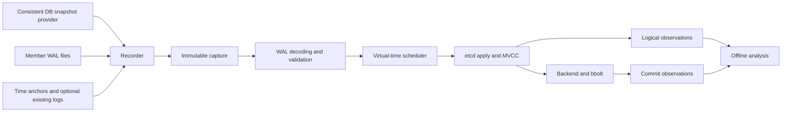

# etcd Trend Recorder and Analyzer Design

etcd Trend records an existing etcd member's persisted history and replays it offline to investigate database growth and fragmentation. The analyzer uses the etcd storage implementation to measure the effects of recorded writes, deletes, leases, and compaction. It supports accelerated replay without making the selected simulation schedule depend on playback speed.

The implementation includes recording, accelerated replay, and object/resource analysis with exact MVCC accounting and explicit estimates of physical contributions. [Object analysis](object-analysis.md) defines the hooks, per-window metrics, allocation model, and disk-backed output. The [offline Web UI and TUI](offline-ui.md) share a disk-backed query layer over completed analysis outputs for interval rankings and object timelines. Workload experiments and calibration remain extensions. Recovery of a production cluster is outside the scope.

## Decisions

| Area | Decision |
| --- | --- |
| Deployment | One Go executable, `etcd-trend`, with `record`, `replay`, `web`, `tui`, `inspect`, `demo`, `loadtest`, and `compat` subcommands. Recording and analysis run as separate invocations. The recorder starts a recording session; it does not start, stop, or reconfigure etcd. |
| Production access | Capture persisted files through a snapshot provider and a WAL archiver. No etcd Watch, keyspace Range, replication membership change, or recorder initiated maintenance. |
| Replay engine | Reuse the pinned etcd apply, MVCC, backend, and bbolt implementations. Maintain narrowly scoped analyzer-only adaptations for scheduling and observations. |
| Time | Use virtual time for simulation. Playback pacing supports 1x, accelerated rates, and an unpaced maximum-speed mode. |
| Compaction | Replay recorded MVCC compaction requests. Model the local physical cleanup schedule explicitly. |
| Calibration | Optional. Accept existing logs, monitoring samples, and consistent DB checkpoints without making them prerequisites for replay. |
| Evidence | Preserve raw capture data. Distinguish captured facts, modeled scheduling, and experimental comparisons in the output. |
| Tenant metadata | Decode JSON/protobuf during offline apply; retain only selected metadata and configured label keys. Join Namespace labels at historical window endpoints. Expose absent/encrypted metadata and window-end attribution explicitly. |

Source compatibility covers stable etcd 3.4.x, 3.5.x, and 3.6.x. The storage simulation remains pinned to etcd v3.6.0. The report identifies both versions: it measures the captured workload under the 3.6.0 model, rather than claiming the original release's exact physical layout. Representative actual source releases are exercised by the compatibility fixture; accepting a patch version is not proof that every operation in every patch has been qualified.

Older sources encode some cluster-version and member-attribute metadata as legacy v2 requests. The adapter translates those internal requests into the corresponding membership operations. Genuine v2 user-keyspace writes are rejected. Offline baseline recovery skips serving-member upgrade gates through an explicit replay-only path; it does not turn the analyzer into a cluster upgrade mechanism.

The root Go module builds the complete executable and supports `go install github.com/yckao/etcd-trend@latest`. The adapted etcd server source remains under `third_party/etcd-server` as packages in that module. The container image invokes the same executable directly; no command-dispatch shell script or separate application binaries are required.

## Data flow

Each capture belongs to one member and one storage generation. Member identity, data-directory replacement, and restore events must not be silently combined into a single history.

## Recorder

The recorder performs bounded file acquisition and records enough metadata to verify and interpret the capture offline. It does not decode Kubernetes objects or compute rankings on the source host.

### Session lifecycle

1. Start acquiring the available WAL sequence and record its identity and initial time anchors.
2. Acquire the baseline through the selected snapshot provider while WAL acquisition continues.
3. Persist the baseline and its provenance. Read its consistency metadata from the saved copy.
4. Continue incrementally archiving WAL files and recording time anchors.
5. On stop, preserve the readable tail, finish capture validation, and record the captured coverage and any gap.

Starting WAL acquisition before the baseline closes the acquisition window around the snapshot. The analyzer chooses the replay starting point from the saved DB's consistent index, rather than assuming that recording start and snapshot completion are the same boundary.

### Snapshot provider

The provider returns a consistent physical DB image and provenance describing how it was obtained. Initial provider forms are an explicitly supplied immutable checkpoint and an explicitly configured external snapshot producer. A storage or filesystem integration can implement the same contract later.

The default recorder does not call the etcd Snapshot RPC. It does not treat an ordinary copy of a changing `member/snap/db` as a consistent snapshot. It also does not open the live DB with bbolt and acquire a database lock. Physical page layout should be retained in the baseline; exporting current keys into a new database would change the fragmentation starting point.

The provider owns snapshot consistency. The recorder owns preservation, checksums, provenance, and validation of the saved artifact. File acquisition still consumes storage bandwidth; deployment must account for that cost instead of describing file access as zero overhead.

### WAL archiver

The archiver incrementally copies the active segment using ordinary read access. It neither acquires etcd's WAL locks nor changes etcd retention settings. Directory notifications can wake acquisition, but periodic reconciliation is needed because notifications are not a durable event log.

A segment remains a partial artifact until rotation and validation establish its sealed contents. Capture state records source identity, sequence, saved offset, and checksum. An incomplete trailing frame is retained or deferred while recording; it is never interpreted as a complete operation. Corruption inside the readable history is an error, not a reason to skip ahead.

The archiver detects missing segments, source replacement, and archive write failures. It reports a gap rather than silently presenting a partial sequence as a complete recording. A poll reconciles the currently visible source directory and unsealed segments; it does not revisit every historical archived segment. Checksums and coverage are maintained incrementally. Session finalization does not load archived payloads. Future resume support must verify the stored prefix against the current source before appending to it.

Raw WAL bytes remain the evidence source. Auxiliary indexes and parsed event streams are derived data that the analyzer can rebuild.

### Time anchors

Anchors associate observed WAL positions with recorder observation time. The first milestone records complete-prefix offsets and wall time once per acquisition pass; entries first observed together share an anchor. A later format can also retain monotonic elapsed time. A file observation time is not automatically the execution time of every entry preceding it.

The analyzer uses the anchors to construct a recorded-time mapping. Interpolation and any unresolved intervals remain explicit model inputs. The replay engine accepts this mapping separately from WAL decoding so a more accurate anchoring method can be added without changing the engine.

### Capture contract

The logical capture contains:

| Artifact | Contents |
| --- | --- |
| Manifest | Format version, source etcd version, member and cluster identity, storage generation, baseline provenance, engine-relevant settings, and coverage status. |
| Baseline DB | Consistent physical image used as the replay starting state. |
| WAL archive | Original segments and the captured active tail, with saved lengths and checksums. |
| Time anchors | Recorded time and WAL-position associations, including resolution. |
| Session journal | Snapshot acquisition, rotation, gaps, and optional maintenance or lifecycle events. |

The on-disk field names and command syntax are defined by the implementation. Artifact paths are relative to the capture root. A capture must not depend on absolute source paths remaining accessible.

## Analyzer

The analyzer treats a capture as immutable and creates a separate writable runtime directory for each run. It never repairs or modifies source artifacts in place.

### Decode and validate

The loader validates the capture identity, segment sequence, framing, checksums, and replay coverage. It reconstructs the final committed entry sequence using Raft hard state and the WAL's entry replacement semantics.

The loader decodes preserved records with the upstream raw WAL decoder. It does not fabricate a Raft snapshot marker from the DB consistent index: these are different coordinates. Entries already reflected by the baseline are skipped only after the loader has reconstructed and checked the required sequence.

The resulting input carries the source term and index, decoded internal request, captured position, and assigned virtual time. Unsupported operations or source versions are reported explicitly. The loader must not silently reinterpret unknown requests as no-ops.

The CLI uses two bounded-payload phases. Preparation streams the complete WAL once for SHA256, native CRC, identity, hard-state, and coverage checks while building a 48-byte fixed-width disk record for each canonical entry. Overwritten uncommitted suffixes truncate that index; the final hard state removes the uncommitted tail. A separate 16-byte record per time anchor avoids retaining the session's timestamp history in memory. Raw values remain only in the capture.

Only after preparation succeeds does replay read one indexed entry at a time. Preparation is included separately in CLI timing: hashing and validation of a 1.21 TB capture have a real I/O cost even when replay pacing is unbounded. The default index lives in a temporary directory outside the capture and is deleted on exit. An explicit `--index-dir` retains a new index directory; reusing a prepared index is not yet implemented. The legacy in-memory loader remains available for small qualification tests.

### Storage runtime

The runtime reconstructs the baseline's MVCC and lease state, then applies committed requests through the corresponding etcd implementation. It maintains consistent-index handling and preserves transaction boundaries and compare behavior.

The analyzer does not run a networked Raft cluster. It supplies the runtime dependencies needed to apply the captured sequence. Lease grants, checkpoints, and revocations come from that sequence; the analyzer does not autonomously create additional lease expirations from its host clock.

Alarm, authorization, membership, and maintenance requests need version-specific handling. The first supported operation set must be documented and tested; unsupported history ends the run with a useful error rather than producing an apparently complete report.

### Virtual time and acceleration

The scheduler owns virtual time and the ordering of apply, periodic backend commit, and physical compaction work. It advances to the next event. Playback pacing optionally waits to achieve a requested rate; maximum-speed mode omits that wait.

Native commit conditions still apply: batch limits, operations that force a commit, and compaction-triggered commits. The periodic backend timer is adapted to virtual time. Changing playback from 1x to 100x must not change the selected virtual commit schedule.

Physical compaction is also scheduler controlled. Its batches, commit behavior, and configured inter-batch delay must have deterministic ordering relative to replayed requests. Replacing sleeps without controlling job scheduling would leave execution dependent on host goroutine timing.

The first milestone uses serial physical compaction: apply stops at the recorded compaction request until its cleanup finishes, with deterministic handling of the cleanup's commits. This policy is identified in the run metadata because it does not reproduce production interleaving. A later cooperative batch scheduler can model interleaving without changing the capture contract.

Maximum speed is bounded by decoding, application, and local storage throughput. It is not a promise that a requested rate can be sustained on every machine.

### Commit observations

Measurements are attached to actual commits in the selected simulation schedule. Observing an operation must not force an extra commit. Each observation associates its virtual time and covered source entries with backend size, in-use size, and the available bbolt page and transaction statistics.

At the end of a run, one explicit final commit persists the applied consistent index, including a trailing sequence of no-ops or requests that made no KV writes. The report labels this finalization boundary separately from timer and operation-triggered commits.

MVCC hooks observe the executed mutations, affected keys, value sizes, revisions, and lease effects. Object analysis joins those observations to commit batches and compaction work, emitting per-window counts and stocks. Its explicit allocation model reconciles estimated physical shares to global measurements while retaining an unattributed remainder; shared B+tree pages do not have unique object ownership.

The analyzer's own readers must have controlled lifetimes. A reporting read transaction held across commits could delay page reclamation and change the phenomenon being measured.

Commit and operation records are written incrementally to JSONL files with running counts and SHA256 hashes. `report.json` contains the constant-size summary and references those files. Normal replay does not retain the timelines or final values in result slices. Final logical-state hashing also avoids materializing the complete keyspace. The actual MVCC index and backend working set are still required by the storage simulation.

## Capacity at the production planning rate

The supplied rate is **2,000,000 WAL bytes/s for one member**. It implies approximately 7.2 GB/hour, 172.8 GB/day, and 1.2096 TB/week of uncompressed WAL. At the default 64,000,000-byte segment size, a segment rotates roughly every 32 seconds and a week contains about 18,900 segments. Recording one member does not multiply this budget by cluster membership; recording all three would.

Entry index capacity depends on entry count, not just WAL bytes: `48 × canonical entry count`. Anchor capacity is `16 × recorded anchor count`; a single continuously active segment sampled every 100 ms produces roughly 6.05 million anchors/week, or about 96.8 MB of derived anchor index, plus the original JSONL anchors. Rotation can add anchors. The observation logs scale with operation and commit counts. Baseline size, writable replay DB growth, output logs, temporary files, and storage headroom are additional capacity terms.

Acquisition adds reads on the source storage and writes on the archive storage. These are measured in an isolated load fixture, with recorder and analyzer in separate processes, but production I/O latency effects are deployment specific. A short sustained-rate run verifies the path at that rate; it does not establish week-long resilience, burst tolerance, or production storage impact. Baseline/MVCC memory and file-backed pages can dominate RSS even when historical WAL payload retention is bounded.

## Compaction and defragmentation

An MVCC compaction request is present in the Raft WAL, including its target revision and `Physical` flag. The flag controls waiting for physical completion at the serving member; it is not a trace of the cleanup batches. The exact local cleanup timing and interleaving are absent from WAL and belong to the simulation schedule.

The analyzer uses recorded compaction requests rather than independently running auto-compaction. Restart-resumed compaction must also be considered when the baseline contains scheduled but unfinished work.

Defragmentation is member local and is not represented as a replicated WAL request. A later journal extension can supply known defrag events to the analyzer. An unrecorded event must not be inferred solely from a WAL segment rotation or a change in write volume.

## Optional calibration

Calibration imports existing evidence. It does not introduce production watches or additional database queries.

Useful inputs include commit histogram counts per time window, compaction completion logs containing size and revision, and consistent DB checkpoints containing bbolt transaction IDs and etcd consistent indexes. Transaction-ID differences are meaningful only within the same physical DB generation, without intervening defrag or reconstruction.

These inputs constrain commit frequency, progress, compaction duration, and space curves. They do not uniquely recover all historical batch boundaries. The analyzer should report fit and parameter sensitivity, including whether object rankings remain stable across plausible schedules. It should not overfit one endpoint size.

## First milestone and validation

The first milestone demonstrates passive recording and accelerated storage replay against a disposable local etcd fixture. The fixture may use maintenance APIs to create reference data; that does not authorize those operations in the production recorder.

Its implementation boundary is explicit:

| Included | Deferred |
| --- | --- |
| Snapshot import and an explicit external snapshot command, with `CAPTURE_SNAPSHOT_PATH` as its destination contract. | Automatic selection of a production snapshot mechanism. |
| Raw WAL acquisition, polling anchors, validation, disk-backed committed entry index, and streaming replay/output. | Recorder restart recovery, long-term capture retention, and defrag-event ingestion. |
| Stable 3.4–3.6 source adapters, one pinned 3.6.0 runtime, a manual backend scheduler, serial compaction, and paced or unpaced replay. | Native physical models for each source release and modeled compaction/write interleaving. |
| Commit observations, final logical-state verification, and per-window object/resource accounting and estimated physical associations. | Counterfactual workload comparisons, enrichment of Kubernetes identities, and calibration imports. |

Acceptance requires:

- A capture produced while the fixture writes, including large repeated updates, deletes, lease revocation, and MVCC compaction.
- The capture remains readable after the original fixture is stopped and its source directory is unavailable.
- Recorder and analyzer checks show that source files were not modified by acquisition or analysis.
- Incomplete tails, corruption, missing history, and incompatible inputs produce explicit coverage or validation outcomes.
- Baseline replay agrees with the fixture's expected logical keyspace and revision at the comparison point.
- Replaying the same capture at different pacing rates and maximum speed yields the same logical result and modeled commit sequence.
- Space observations are recorded without adding per-entry commits, and repeated runs characterize any remaining physical-layout variability.

The milestone produces a machine-readable replay report and a short runnable demonstration. It does not claim production qualification or complete physical equivalence to the source member.

Streaming/indexed replay and observation storage remove payload and timeline retention proportional to recording duration. Full week-long input sizes remain a separate qualification target. Raft membership changes are rejected explicitly in this runtime; normal member-attribute updates are supported.

## Subsequent work

Object/resource window analysis now derives size, update, retained-history, and compaction timelines from actual storage mutations. Further Kubernetes metadata decoding must account for the source serialization and encryption format; raw storage-key and byte analysis already works without decoding values.

Workload comparisons will start from the same baseline and explicit schedule. A baseline run can emit the mutations actually executed, which supports storage-focused experiments without accidentally changing unrelated conditional transaction branches. Changes to transaction semantics must be identified as a separate experiment.

Operational work includes additional snapshot providers, recorder restart recovery, bounded storage retention, additional source-version fixtures and operations, optional calibration imports, and longer-duration qualification.

## Source references

- [etcd persistent storage files](https://etcd.io/docs/v3.6/learning/persistent-storage-files/)
- [etcd v3.6.0 WAL implementation](https://github.com/etcd-io/etcd/blob/v3.6.0/server/storage/wal/wal.go)
- [etcd v3.6.0 apply entry point](https://github.com/etcd-io/etcd/blob/v3.6.0/server/etcdserver/apply/uber_applier.go)
- [etcd v3.6.0 backend timer and snapshot handling](https://github.com/etcd-io/etcd/blob/v3.6.0/server/storage/backend/backend.go)
- [etcd v3.6.0 backend commit conditions](https://github.com/etcd-io/etcd/blob/v3.6.0/server/storage/backend/batch_tx.go)
- [etcd v3.6.0 compaction request path](https://github.com/etcd-io/etcd/blob/v3.6.0/server/etcdserver/v3_server.go)
- [etcd v3.6.0 physical compaction](https://github.com/etcd-io/etcd/blob/v3.6.0/server/storage/mvcc/kvstore_compaction.go)
- [etcd v3.6.0 backend metrics](https://github.com/etcd-io/etcd/blob/v3.6.0/server/storage/backend/metrics.go)
